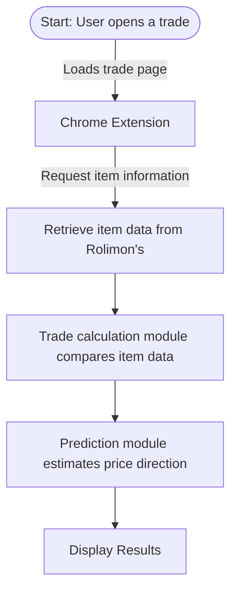

## Project goal

Build a Chrome extension that helps users evaluate Roblox limited-item trades by displaying item information and an estimated price trend alongside the trade window.

# mvp system diagram

# eisenhower matrix
## MVP scope — urgent & important

- chrome extension that displays item information when you are in the trade window
- algorithim that evaluates past sales rap and historical sales to anticipate wheter an item will likely rise or fall
- display prediction alongside trade window

## Future plans / Schedule — important & not urgent

- machine learning to improve prediction accuracy
- suggested trading / counteroffer
- historical price graph or alert for potential value changes

not important & urgent (use a library)

- chrome extension api
- rolimons api to retrieve data
- chart js

not important & not urgent

- ui style
- automated trading scripting
- anything not related to trading limiteds

# Planned tech stack

- JavaScript for extension behavior and trade analysis.
- HTML and CSS for the results panel.
- Chrome Extensions API for browser integration.
- Rolimon's item data as a planned data source, subject to verifying access and available historical data.
- Chart.js for future historical price graphs.
